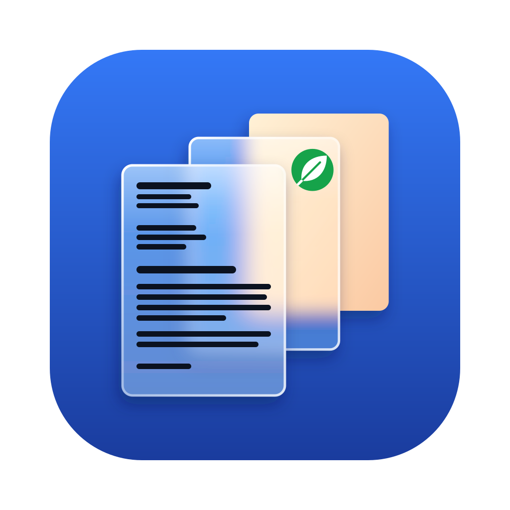

# PDF MRC – gescannte PDFs auf dem Mac verkleinern

*[English](README.md) · Deutsch*



**PDF MRC ist eine kostenlose Mac-App, die gescannte PDFs meist 5- bis 30-mal kleiner macht – per Rechtsklick im
Finder.** Schrift bleibt scharf und durchsuchbar, Farben bleiben erhalten. Auf Wunsch schickt sie Dokumente direkt an
deinen [Paperless-ngx](https://github.com/paperless-ngx/paperless-ngx)-Server.

- **Rechtsklick → Schnellaktionen → PDF komprimieren (MRC)** auf eine oder viele PDFs; die App arbeitet im
  Hintergrund und meldet sich, wenn sie fertig ist.
- **Durchsuchbare PDFs:** Seiten ohne Text werden per Texterkennung (OCR, Tesseract) erfasst; Deutsch und Englisch sind
  dabei, weitere Sprachen lassen sich nachladen.
- **Räumt Scans auf:** entfernt leere Seiten, dreht auf dem Kopf stehende Seiten richtig herum, begradigt schiefe Seiten.
- **Sicher:** Fotos, digitale Seiten und digital signierte PDFs bleiben unberührt; ein Ergebnis wird nur behalten, wenn
  es geprüft und wirklich kleiner ist. Standardmäßig bleibt das Original unverändert – die komprimierte Kopie liegt
  daneben.
- **Paperless-ngx:** PDFs per Rechtsklick an deinen Paperless-Server senden, komprimiert oder unverändert.
- Läuft vollständig auf deinem Mac – keine Cloud, kein Konto.

Beispiel: Ein einseitiger Farbbrief, gescannt mit 300 dpi, schrumpft von etwa 1 MB auf 130 KB; vier Handyscans mit
zusammen sechs Seiten gingen von 12,6 MB auf 0,4 MB.

## So funktioniert es

PDF MRC nutzt *Mixed Raster Content* (MRC), das Verfahren hinter kompakten PDF-Archiven wie dem des Internet Archive.
Eine gescannte Seite wird aufgeteilt in eine scharfe, verlustfrei komprimierte Textebene in voller Auflösung und einen
Hintergrund (Papier, Farbflächen, Bilder) in geringerer Auflösung. Ein normaler Scan speichert jede Seite als ein großes
Foto; MRC behält die Details nur dort, wo sie zählen. Die Verarbeitung übernimmt
[paperless-mrc](https://github.com/Philoneous/paperless-mrc), das auch in Paperless-ngx läuft, mit
[archive-pdf-tools](https://github.com/internetarchive/archive-pdf-tools) des Internet Archive.

## Installation

1. `PDF-MRC.dmg` aus dem [neuesten Release](https://github.com/Philoneous/mac-pdf-mrc/releases/latest) laden.
2. Öffnen und **PDF MRC** in **Programme** ziehen.
3. Erster Start: Die App ist nicht von Apple beglaubigt, macOS blockiert sie deshalb einmal. *Systemeinstellungen →
   Datenschutz & Sicherheit* öffnen, nach unten scrollen und **Dennoch öffnen** klicken.

Voraussetzungen: macOS 13 oder neuer auf einem Mac mit Apple-Chip (M1 oder neuer). Alles Nötige ist enthalten – kein
Homebrew, kein Python, keine weitere Installation.

**Updates** installieren sich selbst: Die App sucht beim Start und alle vier Stunden, lädt neue Versionen im
Hintergrund und installiert sie beim Beenden. Unter *Einstellungen* lässt sich *automatisch installieren*, *vor der
Installation fragen* oder *nur manuell* wählen. Updates sind signiert und werden vor der Installation geprüft.

## Die App benutzen

Die Seitenleiste führt zu *Manuell umwandeln*, *Kontextmenü*, *Paperless*, *Verlauf*, *Einstellungen* und *Info*.

**Manuell umwandeln:** eine PDF ins Fenster ziehen oder auswählen, bei Bedarf Einstellungen anpassen, *Umwandeln*.
Ergebnis und ein ausführliches Protokoll erscheinen darunter; *Im Finder zeigen* öffnet die neue Datei.

**Kontextmenü:** die Finder-Schnellaktion *PDF komprimieren (MRC)* ein- oder ausschalten und ihre Einstellungen wählen.
Dann im Finder eine oder mehrere PDFs rechts anklicken → *Schnellaktionen* → *PDF komprimieren (MRC)*. Die App arbeitet
im Hintergrund, zeigt den Fortschritt in der Menüleiste und meldet jedes Ergebnis als Mitteilung (macOS fragt einmal um
Erlaubnis).

**Paperless:** Adresse deines Paperless-ngx-Servers und API-Token eintragen (in Paperless unter *Mein Profil*), dann
*Speichern und Verbindung testen*. Zwei weitere Schnellaktionen stehen dann bereit:

- **An Paperless senden** – schickt die PDF unverändert; ist paperless-mrc auf dem Server installiert, komprimiert es
  sie dort.
- **Komprimieren und an Paperless senden** – komprimiert zuerst auf dem Mac und schickt das Ergebnis. Sinnvoll bei
  langsamem Server oder langsamem Upload, z. B. unterwegs.

Die Datei auf deinem Mac bleibt in beiden Fällen unverändert. Das Token liegt im macOS-Schlüsselbund. Unterwegs HTTPS
oder ein VPN nutzen – mit `http://` gehen Token und Dokumente unverschlüsselt durchs Netz (die App weist darauf hin).
Selbstsignierte Zertifikate werden nicht unterstützt.

**Verlauf:** die letzten 50 Aufträge mit Ergebnis, Dateigrößen, Dauer jedes Schritts und vollständigem Protokoll (z. B.
welche Seiten als Foto erkannt, gedreht, begradigt oder als leer entfernt wurden).

**OCR-Sprachen:** Deutsch und Englisch sind enthalten. Weitere Tesseract-Sprachen (z. B. `fra`, `ita`, `pol`) im
Sprachfeld der Einstellungen ergänzen; fehlende lädt die App aus
[tessdata_fast](https://github.com/tesseract-ocr/tessdata_fast) nach.

**Sprache der App:** Deutsch oder Englisch, wählbar unter *Einstellungen*.

### Einstellungen

Die Standardwerte sind auf die beste Lesbarkeit des Ergebnisses ausgelegt – ändern musst du nichts. Jede Einstellung
hat in der App eine ⓘ-Erklärung mit ihrem Bereich und der Bedeutung des unteren und oberen Endes.
*Standardwerte wiederherstellen* setzt alles zurück.

| Einstellung | Standard | Bereich | Wirkung |
|---|---|---|---|
| **Seitenauswahl** | | | |
| Auch PDFs mit digitalen Seiten bearbeiten | an | | Komprimiert die gescannten Seiten gemischter PDFs; digitale Seiten bleiben unverändert |
| Fotoseiten unverändert lassen | an | | MRC würde Fotos sichtbar verschlechtern |
| Texterkennung prüft unter Papierfläche | 50 % | 0–100 % | Seiten mit weniger Papier (Fotos, Formulare mit hinterlegten Feldern) gelten nur als Dokument, wenn genug Text erkannt wird |
| Foto unter sicher erkannten Wörtern | 10 | 0–100 | Weniger sicher erkannte Wörter → die Seite gilt als Foto |
| Vektorisierte Scans rastern und durchsuchbar machen | an / 1000 Elemente / 300 dpi | 1–100.000 / 200–600 dpi | Manche Scanner speichern Seiten als Tausende Zeichenelemente; diese werden in ein Bild umgewandelt und durchsuchbar gemacht |
| **Texterkennung** | | | |
| Vorhandene Textebene übernehmen | an | | Aus = Text immer neu erkennen |
| Sprachen | `deu+eng` | | Tesseract-Sprachen, mit `+` verbunden |
| Seiten automatisch drehen / Mindestsicherheit für Drehung | an / 12 | 0–100 | Höher = nur eindeutige Fälle drehen |
| Unsichere Drehung per Texterkennung prüfen | an | | Entscheidet unklare Fälle durch Vergleich beider Lagen – hilft bei Querformat-Formularen |
| Schräglage begradigen / Erst ab Schräglage / Suchbereich / Mindestdeutlichkeit | an / 0,2° / ±5° / 1,3 | 0–2° / 0,5–45° / 1–3 | Begradigt schiefe Seiten; unklare Fälle bleiben, wie sie sind |
| **Leere Seiten** | | | |
| Leere gescannte Seiten entfernen | an | | z. B. leere Rückseiten beim beidseitigen Scannen |
| Leer unter Tintenanteil | 0,005 % | 0–1 % | Eine Seite mit nur einer Seitenzahl hat etwa 0,05 % und bleibt |
| Leer nur ab Papierfläche | 90 % | 0–100 % | Schützt kontrastarme Fotos vor dem Entfernen |
| **Qualität und Größe** | | | |
| Hintergrundauflösung | 1/2 | voll – 1/4 | Schrift behält immer die volle Auflösung |
| Kompressionsrate | 200 | 50–800 | Höher = kleiner; Farbflächen und Bilder werden fleckig |
| Falsche Seitengrößen auf A4 korrigieren | an | | z. B. Handyscans, die ein Vielfaches von A4 groß gespeichert sind |
| Höchstauflösung | aus | 200–400 dpi | Höher aufgelöste Scans verkleinern: schneller und kleiner, feinste Details gehen verloren |
| Nachschärfen / Radius Nachschärfen | 150 % / 1,5 | 0–300 % / 0,5–5 | Hält blasse, dünne Schrift scharf |
| Textmaske, Faktor | 0,5 | 0,1–1,0 | Kleiner = auch blasse Schrift bleibt scharf, aber mehr Schmutzpunkte |
| Gleichzeitige Seiten | automatisch | 1–16 | Automatisch = Anzahl der Prozessorkerne |
| **Ausgabe** | | | |
| Ergebnis | Kopie | | *Als Kopie neben dem Original speichern* (`Rechnung (komprimiert).pdf`) oder *Original ersetzen* (es kommt in den Papierkorb) |

Immer aktiv: Digital signierte PDFs bleiben unverändert, und ein Ergebnis wird nur gespeichert, wenn es geprüft und
kleiner ist.

## Fragen und Probleme

- **Die Schnellaktion erscheint nicht:** *Systemeinstellungen → Tastatur → Tastaturkurzbefehle → Dienste* (bzw.
  *Erweiterungen → Finder*) prüfen.
- **macOS fragt nach Zugriff** auf Schreibtisch, Dokumente oder Downloads, wenn die App dort zum ersten Mal eine Datei
  liest – erlauben.
- **Schlüsselbund-Abfrage nach einem Update:** Die App ist nicht beglaubigt, deshalb hat jede Version eine neue
  Signatur; einmal *Immer erlauben* wählen.
- **Intel-Macs** werden nicht unterstützt (für einen nötigen Baustein, archive-pdf-tools, gibt es keine Intel-Fassung).
- **Deinstallieren:** *PDF MRC* aus Programme löschen, die Schnellaktionen in `~/Library/Services` (*Compress PDF (MRC)*,
  *Send to Paperless*, *Compress and Send to Paperless*) und den Ordner `~/Library/Application Support/mac-pdf-mrc`.

### Alternative: Homebrew-Installer

Ein Skript, das die App lokal baut (braucht [Homebrew](https://brew.sh); keine automatischen Updates):

```bash
bash -c "$(curl -fsSL https://raw.githubusercontent.com/Philoneous/mac-pdf-mrc/main/install.sh)"
```

Es installiert nach `~/Applications/PDF MRC.app`. Wechsel zur DMG-Version: `~/Applications/PDF MRC.app` löschen,
`uv tool uninstall paperless-mrc` ausführen, die DMG-Version installieren und einmal öffnen.

## Unterstützen

PDF MRC ist kostenlos. Wenn es dir Zeit oder Speicherplatz spart, kannst du die Entwicklung auf
[Ko-fi](https://ko-fi.com/Philoneous) unterstützen (PayPal oder Karte, kein Konto nötig) – auch über *Info → Auf
Ko-fi unterstützen* in der App. Beiträge sind freiwillig und keine steuerlich absetzbaren Spenden.

## Entwicklung

`build/build_app.sh dist --standalone` baut die eigenständige App (braucht Homebrew, uv und Netz), entfernt alles, was
paperless-mrc nie lädt, erzeugt die Hinweise zu Drittkomponenten (`build/notices.py`) und prüft, dass jedes
mitgelieferte Programm alle seine Bibliotheken findet (`build/check_bundle.py`); `build/make_dmg.sh dist
dist/PDF-MRC.dmg` packt sie.

GitHub Actions (`.github/workflows/macos.yml`) baut und testet jeden Push auf `main`: Die App wird aus dem DMG
installiert, Homebrew ausgeblendet und dann mit ihrem eigenen Python durchgetestet – Kontextmenü auf Englisch und
Deutsch (`ci/test_app.py`), Sprach-Download, Senden an einen nachgebauten Paperless-ngx-3.3.0-Server
(`ci/test_paperless.py`), Bildschirmfotos und ein echtes Sparkle-Update (`ci/test_update.sh`). Ein zweiter Job testet
den Homebrew-Installer. `ci/check_strings.py` prüft, dass jeder Text übersetzt ist.

**Releases:** *Actions → macOS → Run workflow*, *Patch*, *Minor* oder *Major* wählen – die nächste Nummer wird aus dem letzten Tag berechnet und steht in der Zusammenfassung jedes Laufs (oder eine bestimmte Version eintragen). `build/release.sh` signiert das DMG
für Sparkle (Secret `SPARKLE_PRIVATE_KEY`), schreibt `appcast.xml`, lädt die Quellarchive der mitgelieferten
Copyleft-Komponenten ins Release `third-party-sources` und veröffentlicht das Release. Installierte Apps finden Updates
über `https://github.com/Philoneous/mac-pdf-mrc/releases/latest/download/appcast.xml`.

Die App ruft paperless-mrc so auf wie Paperless: `DOCUMENT_WORKING_PATH` auf eine Kopie, Einstellungen über
`PAPERLESS_OCR_*` und `MRC_*`, Ergebnis aus der Zeile `paperless-mrc-result: {…}`. Statt mit Poppler prüft sie das
Ergebnis mit dem PDF-Darsteller von macOS.

## Lizenz

Copyright © 2026 Philoneous. GNU Affero General Public License v3.0 oder später (`AGPL-3.0-or-later`), siehe
[LICENSE](LICENSE).

**Mitgelieferte Komponenten.** Die App enthält Software Dritter, jeweils unter eigener Lizenz – u. a.
[archive-pdf-tools](https://github.com/internetarchive/archive-pdf-tools) und
[archive-hocr-tools](https://github.com/internetarchive/archive-hocr-tools) (Internet Archive, AGPL-3.0),
[PyMuPDF](https://github.com/pymupdf/PyMuPDF) und [MuPDF](https://mupdf.com) (Artifex, AGPL-3.0),
[pikepdf](https://github.com/pikepdf/pikepdf) (MPL-2.0), [Tesseract](https://github.com/tesseract-ocr/tesseract)
(Apache-2.0), [Python](https://www.python.org) ([python-build-standalone](https://github.com/astral-sh/python-build-standalone)),
NumPy, SciPy, scikit-image, Pillow, OpenJPEG, jbig2enc, Leptonica und [Sparkle](https://sparkle-project.org). Die
vollständige Liste mit Versionen, Lizenzen und Lizenztexten steht in der App unter *Info → Hinweise zu
Drittkomponenten* und hängt an jedem Release als `THIRD-PARTY-NOTICES.txt`. Die genauen Quellarchive aller
Copyleft-Komponenten liegen im Release
[third-party-sources](https://github.com/Philoneous/mac-pdf-mrc/releases/tag/third-party-sources).

PDF MRC ist ein unabhängiges Projekt und steht in keiner Verbindung zu Paperless-ngx, dem Internet Archive oder Artifex.
