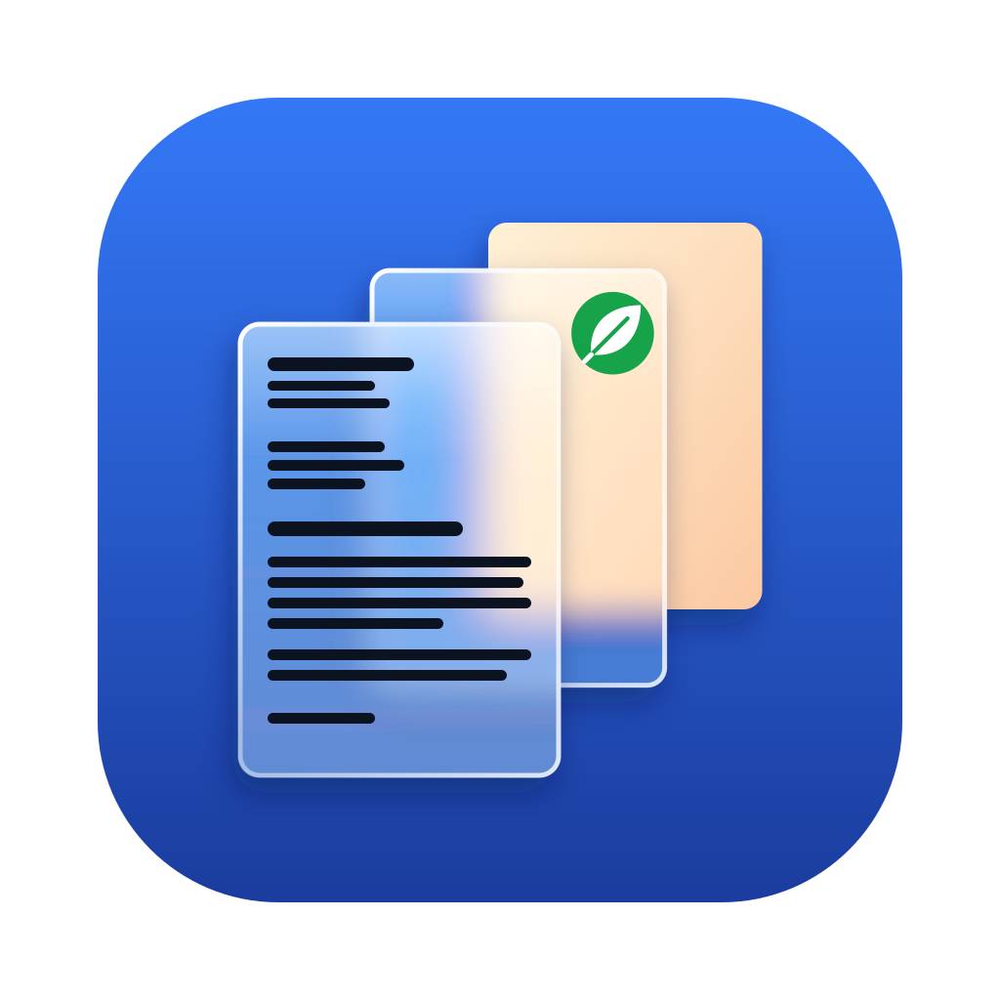

# PDF MRC – compress scanned PDFs on your Mac

*English · [Deutsch](README.de.md)*



**PDF MRC is a free Mac app that makes scanned PDFs typically 5 to 30 times smaller – with a right-click in Finder.**
Text stays sharp and searchable, colours are kept. Optionally it sends documents straight to your
[Paperless-ngx](https://github.com/paperless-ngx/paperless-ngx) server.

- **Right-click → Quick Actions → Compress PDF (MRC)** on one or many PDFs; the app works in the background and
  notifies you when it is done.
- **Searchable PDFs:** pages without text are recognized with OCR (Tesseract; German and English included, more
  languages downloadable).
- **Cleans up scans:** removes blank pages, turns upside-down pages the right way up, straightens skewed pages.
- **Safe:** photos, digital pages and digitally signed PDFs stay untouched; a result is only kept if it was verified
  and is actually smaller. By default the original is not changed – you get a compressed copy next to it.
- **Paperless-ngx:** send PDFs to your Paperless server with a right-click, compressed or unchanged.
- Runs completely on your Mac – no cloud, no account.

Example: a one-page colour letter scanned at 300 dpi shrinks from about 1 MB to 130 KB; four phone scans with six pages
in total went from 12.6 MB to 0.4 MB.

## How it works

PDF MRC uses *Mixed Raster Content* (MRC), the technique behind compact PDF archives such as the Internet Archive's. A
scanned page is split into a sharp, losslessly compressed text layer at full resolution and a background (paper,
coloured areas, pictures) at lower resolution. A normal scan stores each page as one large photo; MRC only keeps the
detail where it matters. The processing is done by [paperless-mrc](https://github.com/Philoneous/paperless-mrc), which
also runs inside Paperless-ngx, using [archive-pdf-tools](https://github.com/internetarchive/archive-pdf-tools) from the
Internet Archive.

## Installation

1. Download `PDF-MRC.dmg` from the [latest release](https://github.com/Philoneous/mac-pdf-mrc/releases/latest).
2. Open it and drag **PDF MRC** to **Applications**.
3. First launch: the app is not notarized by Apple, so macOS blocks it once. Open *System Settings → Privacy &
   Security*, scroll down and click **Open Anyway**.

Requirements: macOS 13 or later on a Mac with Apple silicon (M1 or newer). Everything is included – no Homebrew, Python
or other installation needed.

**Updates** install themselves: the app checks at start and every four hours, downloads new versions in the background
and installs them when it quits. Under *Settings* you can choose *install automatically*, *ask before installing* or
*manually only*. Updates are signed and verified before installation.

## Using the app

The sidebar leads to *Convert manually*, *Context menu*, *Paperless*, *History*, *Settings* and *About*.

**Convert manually:** drop a PDF onto the window or choose one, adjust the settings if you like, click *Convert*. The
result and a detailed log appear below; *Show in Finder* opens the new file.

**Context menu:** switch the Finder Quick Action *Compress PDF (MRC)* on or off and choose its settings. Then
right-click one or more PDFs in Finder → *Quick Actions* → *Compress PDF (MRC)*. The app works in the background, shows
its progress in the menu bar and reports each result as a notification (macOS asks once for permission).

**Paperless:** enter the address of your Paperless-ngx server and your API token (in Paperless under *My Profile*),
then *Save and test connection*. Two more Quick Actions become available:

- **Send to Paperless** – sends the PDF unchanged; if paperless-mrc is installed on the server, it compresses it there.
- **Compress and Send to Paperless** – compresses on the Mac first and sends the result. Useful with a slow server or
  a slow upload, e.g. on the road.

The file on your Mac stays unchanged in both cases. The token is stored in the macOS keychain. Away from home, use
HTTPS or a VPN – with `http://` the token and documents travel unencrypted (the app warns about this). Self-signed
certificates are not supported.

**History:** the last 50 jobs with result, file sizes, duration of each step and the full log (e.g. which pages were
recognized as photos, rotated, straightened or removed as blank).

**OCR languages:** German and English are included. Add more Tesseract languages (e.g. `fra`, `ita`, `pol`) in the
language field of the settings; the app downloads missing ones from
[tessdata_fast](https://github.com/tesseract-ocr/tessdata_fast).

**App language:** English or German, chosen under *Settings*.

### Settings

The defaults are chosen for the best readability of the result – you do not need to change anything. Each setting has
a ⓘ explanation in the app with its range and what the lower and upper end mean. *Restore defaults* resets them.

| Setting | Default | Range | What it does |
|---|---|---|---|
| **Page selection** | | | |
| Also process PDFs with digital pages | on | | Compress the scanned pages of mixed PDFs; digital pages stay unchanged |
| Leave photo pages unchanged | on | | MRC would visibly degrade photos |
| Text check below paper area | 50 % | 0–100 % | Pages with less paper (photos, forms with shaded boxes) only count as documents if enough text is recognized |
| Photo below confident words | 10 | 0–100 | Fewer confidently recognized words → the page is treated as a photo |
| Rasterize vectorized scans and make them searchable | on / 1000 elements / 300 dpi | 1–100,000 / 200–600 dpi | Some scanners store pages as thousands of drawing elements; these are turned into an image and made searchable |
| **Text recognition** | | | |
| Keep existing text layer | on | | Off = always recognize the text again |
| Languages | `deu+eng` | | Tesseract languages, joined with `+` |
| Rotate pages automatically / minimum rotation confidence | on / 12 | 0–100 | Higher = rotate only clear cases |
| Check uncertain rotation with text recognition | on | | Decides unclear cases by comparing both orientations – helps with landscape forms |
| Deskew / minimum skew / search range / minimum skew clarity | on / 0.2° / ±5° / 1.3 | 0–2° / 0.5–45° / 1–3 | Straightens skewed pages; unclear cases are left as they are |
| **Blank pages** | | | |
| Remove blank scanned pages | on | | e.g. empty back sides from double-sided scanning |
| Blank below ink share | 0.005 % | 0–1 % | A page with only a page number has about 0.01 % and is kept |
| Ink contrast for blank | 20 levels | 10–100 | How much darker than the paper a pixel must be to count as ink; 20 keeps pale photos and faded receipts, 40 = behavior before 11/2026 |
| Minimum paper area for blank | 90 % | 0–100 % | Protects low-contrast photos from being removed |
| **Quality and size** | | | |
| Background resolution | 1/2 | full – 1/4 | Text always keeps full resolution |
| Compression rate | 200 | 50–800 | Higher = smaller; coloured areas and pictures get blotchy |
| Correct wrong page sizes | on | | e.g. phone scans stored far too large; A5, receipts and A3 plans stay as they are |
| Target page size | A4 | A4, US Letter, US Legal | Size such pages are scaled down to |
| Maximum resolution | off | 200–400 dpi | Downscale higher-resolution scans: faster and smaller, finest details are lost |
| Sharpening / sharpening radius | 150 % / 1.5 | 0–300 % / 0.5–5 | Keeps faint, thin text crisp |
| Text mask factor | 0.5 | 0.1–1.0 | Smaller = faint text also stays sharp, but more specks |
| Simultaneous pages | automatic | 1–16 | Automatic = number of processor cores |
| **Output** | | | |
| Result | copy | | *Save as a copy next to the original* (`Invoice (compressed).pdf`) or *Replace the original* (it goes to the Trash) |

Always on: digitally signed PDFs stay unchanged, and a result is only saved if it was verified and is smaller.

## Questions and problems

- **The Quick Action does not appear:** check *System Settings → Keyboard → Keyboard Shortcuts → Services* (or
  *Extensions → Finder*).
- **macOS asks for access** to Desktop, Documents or Downloads the first time the app reads a file there – allow it.
- **Keychain prompt after an update:** the app is not notarized, so each version has a new signature; choose
  *Always Allow* once.
- **Intel Macs** are not supported (a required component, archive-pdf-tools, has no Intel build).
- **Uninstall:** delete *PDF MRC* from Applications, the Quick Actions in `~/Library/Services` (*Compress PDF (MRC)*,
  *Send to Paperless*, *Compress and Send to Paperless*) and the folder `~/Library/Application Support/mac-pdf-mrc`.

### Alternative: Homebrew installer

A script that builds the app locally (needs [Homebrew](https://brew.sh); no automatic updates):

```bash
bash -c "$(curl -fsSL https://raw.githubusercontent.com/Philoneous/mac-pdf-mrc/main/install.sh)"
```

It installs to `~/Applications/PDF MRC.app`. To switch to the DMG version: delete `~/Applications/PDF MRC.app`, run
`uv tool uninstall paperless-mrc`, install the DMG version and open it once.

## Support

PDF MRC is free. If it saves you time or storage, you can support its development on
[Ko-fi](https://ko-fi.com/Philoneous) (PayPal or card, no account needed) – also via *About → Support on Ko-fi* in the
app. Contributions are voluntary and not tax-deductible donations.

## Development

`build/build_app.sh dist --standalone` builds the self-contained app (needs Homebrew, uv and network), removes
everything paperless-mrc never loads, generates the third-party notices (`build/notices.py`) and checks that every
bundled program finds all its libraries (`build/check_bundle.py`); `build/make_dmg.sh dist dist/PDF-MRC.dmg` packs it.

GitHub Actions (`.github/workflows/macos.yml`) builds and tests every push to `main`: the app is installed from the DMG
with Homebrew hidden, then tested end to end with its own Python – context menu in English and German
(`ci/test_app.py`), language download, sending to a stand-in Paperless-ngx 3.3.0 server (`ci/test_paperless.py`),
screenshots and a real Sparkle update (`ci/test_update.sh`). A second job tests the Homebrew installer.
`ci/check_strings.py` checks that every text is translated.

**Releases:** *Actions → macOS → Run workflow*, choose *Patch*, *Minor* or *Major* – the next number is computed from the last tag and shown in the summary of every run (or enter a specific version). `build/release.sh` signs the DMG for
Sparkle (secret `SPARKLE_PRIVATE_KEY`), writes `appcast.xml`, uploads the source archives of the bundled copyleft
components to the release `third-party-sources` and publishes the release. Installed apps find updates via
`https://github.com/Philoneous/mac-pdf-mrc/releases/latest/download/appcast.xml`.

The app runs paperless-mrc the way Paperless does: `DOCUMENT_WORKING_PATH` pointing to a copy, settings via
`PAPERLESS_OCR_*` and `MRC_*`, result from the line `paperless-mrc-result: {…}`. Instead of Poppler it checks the
result with macOS's own PDF renderer.

## License

Copyright © 2026 Philoneous. GNU Affero General Public License v3.0 or later (`AGPL-3.0-or-later`), see
[LICENSE](LICENSE).

**Bundled components.** The app contains third-party software, each under its own license – among others
[archive-pdf-tools](https://github.com/internetarchive/archive-pdf-tools) and
[archive-hocr-tools](https://github.com/internetarchive/archive-hocr-tools) (Internet Archive, AGPL-3.0),
[PyMuPDF](https://github.com/pymupdf/PyMuPDF) and [MuPDF](https://mupdf.com) (Artifex, AGPL-3.0),
[pikepdf](https://github.com/pikepdf/pikepdf) (MPL-2.0), [Tesseract](https://github.com/tesseract-ocr/tesseract)
(Apache-2.0), [Python](https://www.python.org) ([python-build-standalone](https://github.com/astral-sh/python-build-standalone)),
NumPy, SciPy, scikit-image, Pillow, OpenJPEG, jbig2enc, Leptonica and [Sparkle](https://sparkle-project.org). The
complete list with versions, licenses and full license texts is in the app under *About → Third-party notices* and
attached to every release as `THIRD-PARTY-NOTICES.txt`. The exact source archives of all copyleft components are in
the release [third-party-sources](https://github.com/Philoneous/mac-pdf-mrc/releases/tag/third-party-sources).

PDF MRC is an independent project and is not affiliated with or endorsed by Paperless-ngx, the Internet Archive or
Artifex.
