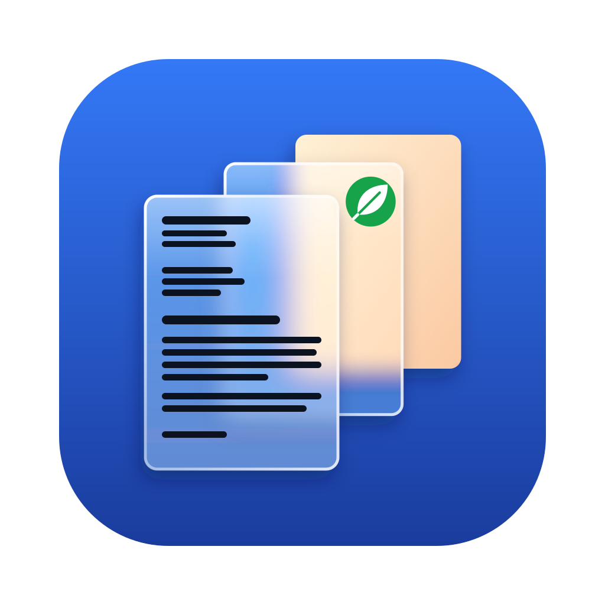

# PDF MRC for macOS

*English · [Deutsch](README.de.md)*



A small Mac app that shrinks scanned PDFs dramatically with *Mixed Raster Content* (MRC) – manually in the app or
with a right-click in Finder – and can send them to a [Paperless-ngx](https://github.com/paperless-ngx/paperless-ngx)
server.

The processing is done by [paperless-mrc](https://github.com/Philoneous/paperless-mrc) – the same script that
compresses new scans inside Paperless-ngx – which in turn uses [archive-pdf-tools](https://github.com/internetarchive/archive-pdf-tools)
from the Internet Archive. Its README explains what happens in detail (scanned pages only, blank pages removed, text
layer kept or recognised with Tesseract, wrong page sizes corrected, result verified).

## Installation

1. Download `PDF-MRC.dmg` from the [latest release](https://github.com/Philoneous/mac-pdf-mrc/releases/latest).
2. Open it and drag **PDF MRC** to **Applications**.
3. First launch: the app is not notarised by Apple, so macOS blocks it once. Open *System Settings → Privacy &
   Security*, scroll down and click **Open Anyway**.

Requirements: macOS 13 or later, Apple silicon. Everything the app needs (Python, paperless-mrc, Tesseract, OpenJPEG,
jbig2enc, Poppler) is inside the app – no Homebrew required.

**Updates** are installed automatically (Sparkle): the app checks once a day, downloads new versions in the
background and installs them when you quit it. *PDF MRC → Settings…* lets you switch this off or check manually.
Updates are signed (EdDSA) and verified before installation.

## Using the app

**Convert manually:** drop a PDF or choose one, adjust the settings, *Convert*. The result and all messages from
paperless-mrc appear below; *Show in Finder* opens the new file.

**Context menu:** switch the Finder Quick Action *Compress PDF (MRC)* on or off and set its own settings (independent
of manual conversion; *Copy settings from manual conversion* copies them over). Right-click one or more PDFs →
*Quick Actions*. Each result appears as a notification.

**Paperless:** address of your Paperless-ngx server and API token (in Paperless under *My Profile*), *Save and test
connection*, and two more Quick Actions:

- **Send to Paperless** – sends the PDF unchanged; Paperless (with paperless-mrc) compresses it there.
- **Compress and send to Paperless** – compresses on the Mac first (settings from the *Context menu* tab) and sends the
  result, or the original if it cannot be made smaller. paperless-mrc on the server leaves such a file unchanged, so
  nothing is converted twice.

The file on your Mac stays unchanged in both cases. The app uploads via `/api/documents/post_document/`, waits up to
three minutes for the result (`/api/tasks/`) and reports it as a notification: created document (with number),
duplicate or error. Connection and token are checked before uploading.

- The token is stored in the macOS keychain. After an update macOS asks once whether the app may still access it
  (*Always Allow*) – the app is ad-hoc signed, so each version has a new signature.
- On a home network macOS asks the first time whether the app may access devices on the local network.
- **When away from home** use HTTPS (e.g. a reverse proxy with a certificate) or a VPN – with `http://` the token and
  documents travel in plain text; the app points this out. Self-signed certificates are not supported.

**Languages:** German and English are included. Other Tesseract languages (e.g. `fra`, `pol`, `chi_sim`) can be added
in the language field of the settings – the app shows missing languages and downloads them from
[tessdata_fast](https://github.com/tesseract-ocr/tessdata_fast) with *Download*. They are stored in
`~/Library/Application Support/mac-pdf-mrc/tessdata`.

The interface follows the system language (German or English; other languages → English).

### Settings (per profile; *Restore defaults* resets them)

| Setting | Default | Effect |
|---|---|---|
| **Page selection** | | |
| Also process PDFs with digital pages | on | digital pages stay unchanged; off = only pure scan PDFs |
| Leave photo pages unchanged | on | MRC visibly degrades photos |
| Text recognition checks below paper area (%) | 50 | pages with less paper area (photos, text on coloured backgrounds) only count as documents if enough text is recognised |
| Photo below confidently recognised words | 10 | words with ≥ 3 characters and high confidence |
| Rasterise vectorised scans | on | pages without image and text made of thousands of vector elements are rasterised and made searchable |
| Vectorised from elements / raster resolution | 1000 / 300 dpi | |
| **Text recognition** | | |
| Keep existing text layer | on | off = always recognise again with Tesseract |
| Languages | `deu+eng` | Tesseract languages; more can be downloaded |
| Rotate pages automatically / minimum confidence | on / 12 | only pages without a kept text layer |
| Deskew / only from / search range ± | on / 0.2° / 5° | a result at the edge of the search range counts as ambiguous → no correction |
| Minimum skew clarity | 1.3 | only deskew if the best angle clearly stands out; prevents logos or stamps on text-poor pages from tilting a straight page |
| **Blank pages** | | |
| Remove blank scanned pages | on | |
| Blank below ink share (%) | 0.005 | a page with only a page number is about 0.05 % |
| Blank only from paper area (%) | 90 | protects low-contrast photos from being removed as blank |
| **Quality and size** | | |
| Background resolution | 1/2 | text and lines always stay at full resolution |
| Compression rate | 200 | higher = smaller; colour areas and light-grey text suffer |
| Correct wrong page sizes to A4 | on | e.g. phone scans with 61 × 86 cm |
| Sharpening / radius | 150 % / 1.5 px | light-grey, thin text stays sharp; 0 = off |
| Text mask: factor | 0.5 | smaller = light-grey text also stays sharp; 1 = recode_pdf default |
| Maximum resolution | off | downscale higher-resolution scans (e.g. 300 dpi): faster and smaller |
| Simultaneous pages | automatic | number of processor cores |
| **Output** | | |
| Result | copy | *As a copy next to the original* (`<name> (compressed).pdf`, suffix configurable) or *Replace original* (original to the Trash) |

Not switchable (safety): digitally signed PDFs stay unchanged, and a result is only produced if it was verified and is
smaller. Otherwise no file is created and the original stays as it is; an existing copy is not overwritten.
Settings are stored in `~/Library/Application Support/mac-pdf-mrc/settings.json`.

## Notes

- If a Quick Action does not appear: check *System Settings → Keyboard → Keyboard Shortcuts → Services*.
- The first time the app accesses Desktop, Documents or Downloads, macOS asks for permission.
- **Uninstall:** delete *PDF MRC* from Applications, the Quick Actions in `~/Library/Services` (*PDF komprimieren
  (MRC)*, *An Paperless senden*, *Komprimieren und an Paperless senden*) and `~/Library/Application Support/mac-pdf-mrc`.
- Intel Macs are not supported (archive-pdf-tools has no prebuilt Intel package).

### Alternative: Homebrew installer (backup)

The previous way still works and builds the app locally (needs [Homebrew](https://brew.sh)); it updates by running the
same command again and has no built-in updater:

```bash
bash -c "$(curl -fsSL https://raw.githubusercontent.com/Philoneous/mac-pdf-mrc/main/install.sh)"
```

It installs to `~/Applications/PDF MRC.app`. **Switching to the DMG version:** delete `~/Applications/PDF MRC.app`,
run `uv tool uninstall paperless-mrc`, install the DMG version and open it once (it re-creates the Quick Actions).

## Development

`build/build_app.sh dist --standalone` builds the self-contained app (Homebrew, uv and network needed for building);
`build/make_dmg.sh dist dist/PDF-MRC.dmg` packs it. GitHub Actions (`.github/workflows/macos.yml`) builds and tests on
every push to `main`, two jobs in parallel:

- **App (DMG):** build, DMG, install from the DMG to `/Applications`, **hide Homebrew**, then end-to-end tests with the
  app's own Python: context menu mode in English and German (`ci/test_app.py`), language download, sending to a
  stand-in server that behaves like Paperless-ngx 3.3.0 (`ci/test_paperless.py`, `ci/paperless_mock.py`), screenshots,
  and a real **Sparkle update** from a local feed (`ci/test_update.sh`).
- **Homebrew installer (backup):** `install.sh` from the checkout and the same tests.

`ci/check_strings.py` checks that every text has an English translation. If a step fails, its last output lines are
attached to the run as an annotation; on a manual run the screenshots are also pushed to the branch `ci-screenshots`.

**Releases:** *Actions → macOS → Run workflow* on `main` with a version (e.g. `1.0.0`), or push a tag `vX.Y.Z`.
The workflow builds and tests as above, then `build/release.sh` signs the
DMG for Sparkle (repository secret `SPARKLE_PRIVATE_KEY`, checked against `SUPublicEDKey` in the app), writes
`appcast.xml` and creates the GitHub release. Installed apps find it via
`https://github.com/Philoneous/mac-pdf-mrc/releases/latest/download/appcast.xml`. A normal push does not trigger an
update.

The app runs paperless-mrc the way Paperless does: `DOCUMENT_WORKING_PATH` pointing to a copy, settings via
`PAPERLESS_OCR_*` and `MRC_*`, result from the machine-readable line `paperless-mrc-result: {…}`.

## Licence

GNU Affero General Public License v3.0 or later (`AGPL-3.0-or-later`), see [LICENSE](LICENSE) – like paperless-mrc.
